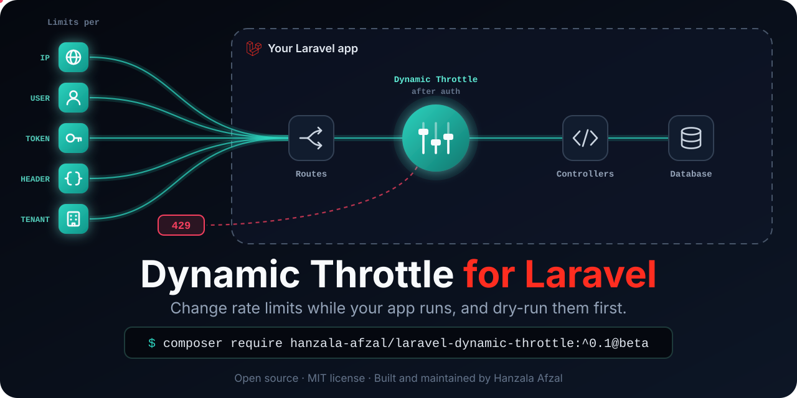
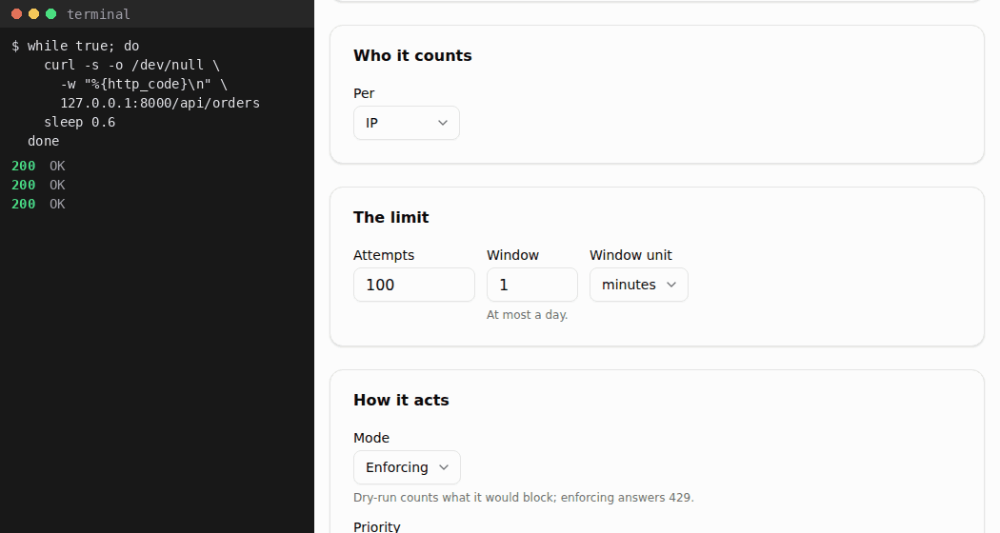

<!-- Packagist shows this README's images through rawcdn.githack.com, which caches each address for good: give a changed image a new file name, or Packagist keeps showing the old one. -->
<p align="center">
  
</p>

<p align="center">
  <a href="https://packagist.org/packages/hanzala-afzal/laravel-dynamic-throttle"></a>
  <a href="https://github.com/hanzala-afzal-dev/laravel-dynamic-throttle/actions/workflows/ci.yml"></a>
  <a href="https://packagist.org/packages/hanzala-afzal/laravel-dynamic-throttle"></a>
  
  
  <a href="LICENSE"></a>
</p>

<!-- #region beta -->

> [!IMPORTANT]
> **Public beta.** Everything planned for 0.1.0 is in, but names and options may still change, and the [changelog](CHANGELOG.md) will say how to upgrade. Try it in staging first, and [tell us](#beta-feedback) what breaks or confuses you.

<!-- #endregion beta -->

**Dynamic Throttle for Laravel** lets you change your app's rate limits while it runs: per IP, user, API token, header or tenant, with a dry-run mode, exemptions, emergency switches and a dashboard.

<!-- #region why -->

## Why

Laravel's `throttle` middleware works for limits you know up front. In production, you learn the right limits later, and in a hurry: a partner's integration starts getting 429s, a bot hammers `/login` at 2 a.m., or you want a stricter limit without knowing who it would block. With `throttle`, each fix is a code change and a deploy, and you still can't see who is blocked.

Dynamic Throttle makes limits data. Rules live in your database, you change them from a dashboard, Artisan or code, and every server applies the change within seconds.

| You want to | Laravel's `throttle` | Dynamic Throttle |
|---|---|---|
| Change a limit | Edit code and deploy | Edit the rule; servers apply it within 2 seconds |
| Try a limit before it blocks anyone | Not possible | Dry-run: the rule counts, never blocks, and reports who it would block |
| See who is blocked | Add your own logging | A live feed, and each rule's top offenders |
| Let a partner or a user through | A code change | An exemption, with an end date |
| Lift every limit during an incident | A deploy | `dynamic-throttle:bypass on --for=30m`, which ends by itself |
| Limit per tenant or plan | A custom limiter closure | A custom scope and one rule |
| Know why a request was blocked | Read the code | The Explain page, or `dynamic-throttle:explain` |
| Keep serving when Redis is down | An exception per request | Requests go through, or get a 503 on the rules you choose |

Requests never read the rules from the database: they are compiled into your cache. On local Redis, the middleware adds about 0.8 ms per request at p50 with APCu, against 1.0 ms for Laravel's `throttle` and 0.6 ms for its `throttleWithRedis()` ([performance](docs/guide/performance.md)). It is not a firewall or bot detection, and it does not replace edge rate limiting such as Cloudflare or Nginx. Use it for limits that need to know who the client is.

<!-- #endregion why -->

## The dashboard

It ships with the package at `/dynamic-throttle`, behind your gates, with nothing to build: Overview, Rules, Exemptions, Activity (a live feed of blocks), Explain, Audit log and Settings, in light and dark themes.

<p align="center">
  
</p>

<!-- #region getting-started -->

## Requirements

- PHP 8.3+, and Laravel 12.69+ or 13.30+.
- A counter store: Redis 6.2+ or Valkey 7.2+ is best, and the live feed and offenders need one. Memcached and the database store work too, but not `file` or `apc` in production.
- On PHP-FPM, the APCu extension, so a server's workers share the rules.

## Installation

**1. Install the beta:**

```bash
composer require hanzala-afzal/laravel-dynamic-throttle:^0.1@beta
```

**2. Create the tables, and compile the rules once.** After this, saving a rule compiles them, and so does the scheduler.

```bash
php artisan vendor:publish --tag=dynamic-throttle-migrations
php artisan migrate
php artisan dynamic-throttle:compile
```

**3. Attach the middleware** to the routes rules may limit, in `bootstrap/app.php`. Routes without it are never limited.

```php
->withMiddleware(function (Middleware $middleware) {
    $middleware->appendToGroup('api', 'dynamic.throttle');
})
```

**4. Say who may use the dashboard**, in a service provider's `boot()`. Until you do, only the `local` environment gets in, and `php artisan dynamic-throttle:health` warns everywhere else.

```php
use App\Models\User;
use Illuminate\Support\Facades\Gate;

Gate::define('viewDynamicThrottle', fn (User $user) => $user->is_admin);
Gate::define('manageDynamicThrottle', fn (User $user) => $user->is_admin);
```

**5. Run [Laravel's scheduler](https://laravel.com/docs/scheduling#running-the-scheduler).** It recompiles the rules every five minutes and stores the traffic numbers every minute.

Then check your setup with `php artisan dynamic-throttle:health`.

## Usage

Add a rule in the dashboard under **Rules → New rule**, from a template such as "Login" or "API per user". New rules start in dry-run: they count requests and show who they would block, but block no one until you promote them.

Or from code:

```php
use Afzal\DynamicThrottle\Models\Rule;

Rule::create([
    'name' => 'API per user',
    'pattern' => 'api/*',
    'scope' => 'user',        // ip, user, api_token, header, global or custom
    'max_attempts' => 60,
    'window_seconds' => 60,
]);
```

Each user now gets 60 requests a minute under `/api`. The 61st gets Laravel's own 429, with `Retry-After` and `X-RateLimit-*` headers.

| Command | What it does |
|---|---|
| `dynamic-throttle:health` | Looks for setup mistakes. `--strict` fails on a warning too |
| `dynamic-throttle:explain GET /api/orders --user=42` | Shows why a request would be allowed or limited, without counting it |
| `dynamic-throttle:status` | Shows what the servers apply now, and until when |
| `dynamic-throttle:bypass on --for=30m` | Lifts every limit until the end time |
| `dynamic-throttle:scale 2 --for=2h` | Multiplies every limit: `2` doubles them, `0.5` halves them |
| `dynamic-throttle:disable-rule 12`, `enable-rule 12` | Switches one rule off or back on |
| `dynamic-throttle:list` | Lists every rule with its id |
| `dynamic-throttle:compile` | Recompiles the rules now |

<!-- #endregion getting-started -->

## Documentation

The [guide](docs/guide/README.md) has the details, also on the [documentation site](https://hanzala-afzal-dev.github.io/laravel-dynamic-throttle/), with search:

- [Rules](docs/guide/rules.md): every attribute, examples, your own scope, and exemptions
- [An endpoint that costs money](docs/guide/rules.md#an-endpoint-that-costs-money), such as one that calls an AI model: a limit per user or per plan, tried in dry-run first
- [Dry-run rules](docs/guide/dry-run.md), [events](docs/guide/events.md) and [testing your app](docs/guide/testing.md) with `DynamicThrottle::fake()`
- [Configuration](docs/guide/configuration.md), [attaching the middleware](docs/guide/middleware.md), and [storage and runtimes](docs/guide/storage-and-runtimes.md)
- [The dashboard](docs/guide/dashboard.md), [health checks](docs/guide/health.md) and [during an incident](docs/guide/incidents.md)
- The [runbook](docs/runbook.md): Redis is down, the manifest was evicted, a bad rule blocks `/api`, or an emergency change was left on

<!-- #region beta-feedback -->

## Beta feedback

What helps most:

- Did it install cleanly on your Laravel and PHP versions, cache store and runtime (PHP-FPM, Octane, Vapor)?
- Did a rule do something you did not expect? Paste the output of `php artisan dynamic-throttle:explain`.
- Was anything in the dashboard or the docs unclear?

Report bugs in [issues](https://github.com/hanzala-afzal-dev/laravel-dynamic-throttle/issues/new/choose), and bring questions and ideas to [discussions](https://github.com/hanzala-afzal-dev/laravel-dynamic-throttle/discussions). Report security issues privately, as [SECURITY.md](SECURITY.md) explains, never in a public issue.

<!-- #endregion beta-feedback -->

## License

MIT, © 2026 [Hanzala Afzal](https://github.com/hanzala-afzal-dev). See [LICENSE](LICENSE), [CONTRIBUTING.md](CONTRIBUTING.md) and the [changelog](CHANGELOG.md).

An independent package, not affiliated with or endorsed by Laravel. "Laravel" is a trademark of its respective owner.
